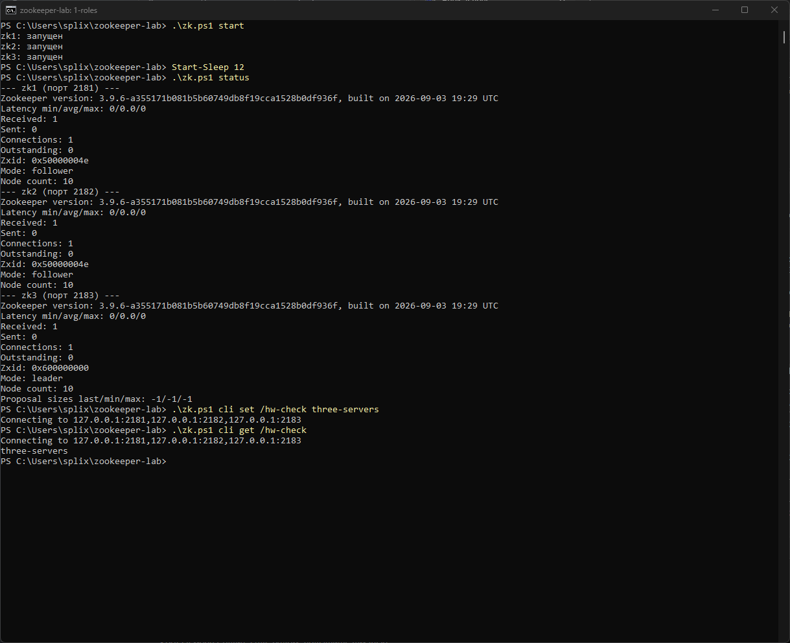
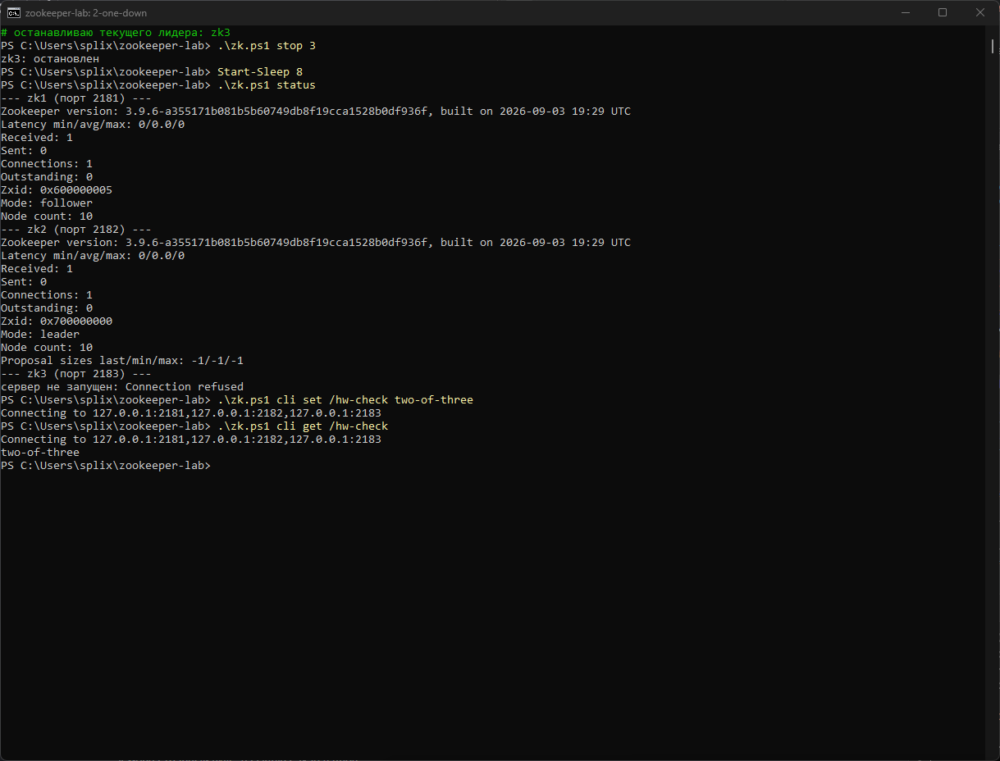
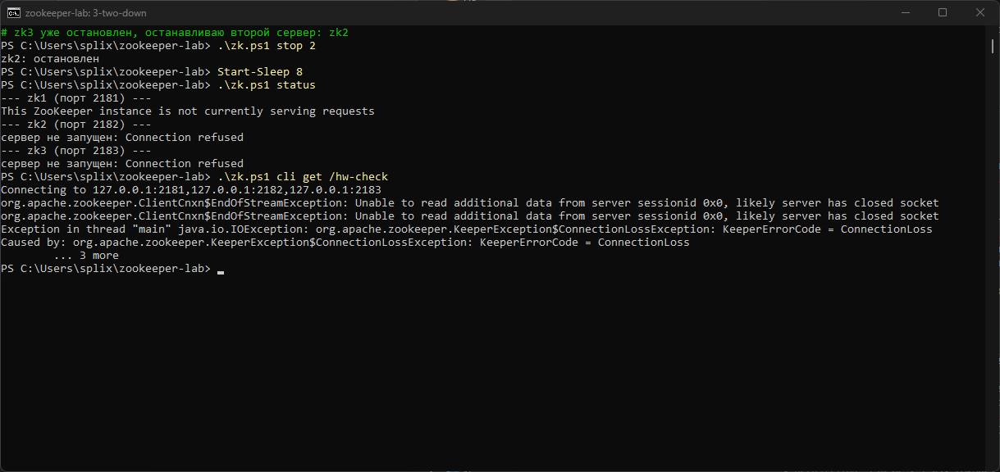
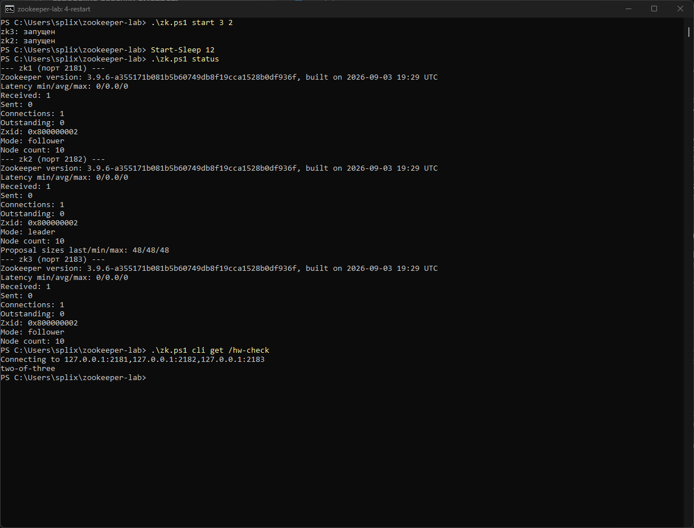
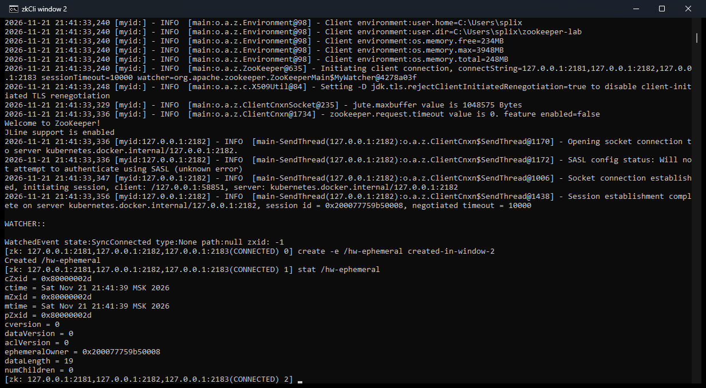
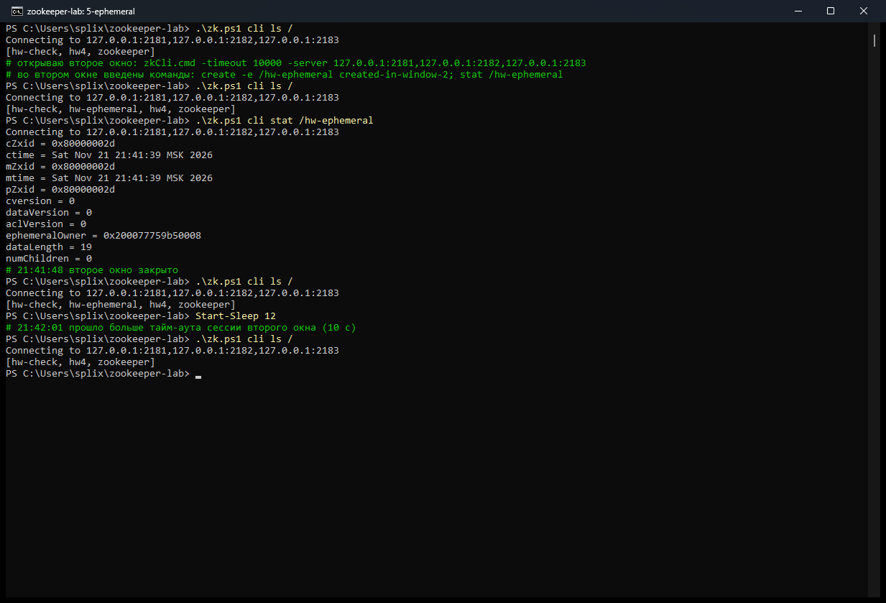
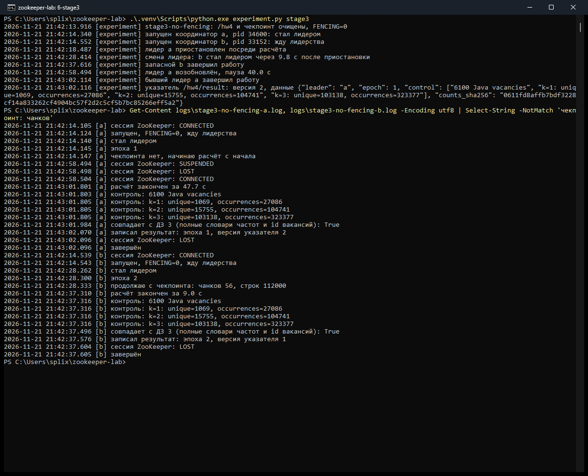
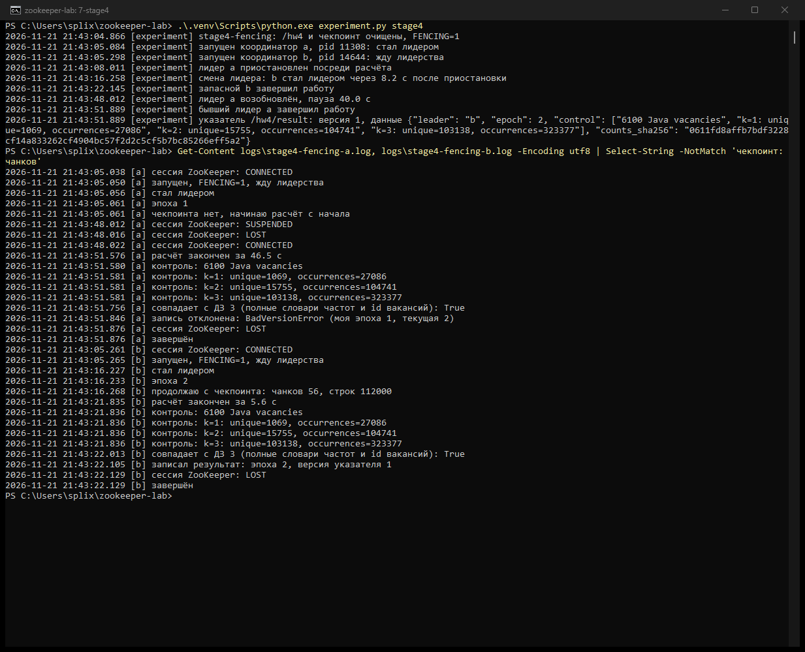

# Обеспечение отказоустойчивости средствами Apache ZooKeeper

Ансамбль из трёх серверов ZooKeeper 3.9.6 (три распакованные копии на Windows 11, Java 17) и координатор расчёта из ДЗ 3 с выбором лидера, чекпоинтом и защитой по эпохе.

| Что | Где |
|---|---|
| Конфигурации серверов и `myid` | `zk1/conf/zoo.cfg`, `zk2/…`, `zk3/…`; `zkN/data/myid` |
| Запуск, остановка, роли серверов, команды zkCli | `zk.ps1` |
| Координатор | `coordinator.py` |
| Сценарий этапов 3–4 (запуск двух копий, приостановка лидера) | `experiment.py` |
| Журналы координаторов | `logs/` |
| Выводы команд текстом | `outputs/` |
| Скриншоты (снимки окон консоли, в которых выполнялись команды) | `screenshots/` |

## Этап 1. Установка

Использовалась Java 17.0.12. `JAVA_HOME` задан как переменная пользователя: `C:\Program Files\Java\jdk-17`. Архив `apache-zookeeper-3.9.6-bin.tar.gz` скачан с archive.apache.org, контрольная сумма SHA-512 совпала. Архив распакован в три копии: `zk1`, `zk2`, `zk3`. Вывод команд — в `outputs/stage1-install.txt`.

## Этап 2. Ансамбль

Конфигурация `zk1/conf/zoo.cfg`:

```
tickTime=2000
initLimit=10
syncLimit=5
dataDir=C:/Users/splix/zookeeper-lab/zk1/data
clientPort=2181
admin.serverPort=8081
4lw.commands.whitelist=srvr,stat,ruok
server.1=127.0.0.1:2888:3888
server.2=127.0.0.1:2889:3889
server.3=127.0.0.1:2890:3890
```

Строки `server.N` во всех трёх файлах одинаковые. У каждого сервера свои `clientPort` (2181/2182/2183), `admin.serverPort` (8081/8082/8083) и `dataDir`. Все серверы работают на одном компьютере, поэтому у каждого в строке `server.N` свои порты кворума и выборов. В `zkN/data/myid` записан номер сервера N.

Серверы запускаются штатной командой `zkN\bin\zkServer.cmd`, каждый в своём окне (`.\zk.ps1 start`). Роль сервера показывает команда `srvr` (`.\zk.ps1 status`).

| Шаг | Результат | Вывод |
|---|---|---|
| Запущены три сервера | zk3 — leader, zk1 и zk2 — follower; запись `/hw-check` прошла | `outputs/stage2-1-start.txt`, `screenshots/1-roles.png` |
| Остановлен zk3 (лидер) | zk2 стал лидером, zk1 остался follower; `set` и `get` работают | `outputs/stage2-2-one-down.txt`, `screenshots/2-one-down.png` |
| Остановлен ещё zk2 | zk1: `This ZooKeeper instance is not currently serving requests`, клиент получает `ConnectionLoss` | `outputs/stage2-3-two-down.txt`, `screenshots/3-two-down.png` |
| zk3 и zk2 запущены снова | zk2 — leader, zk1 и zk3 — follower, данные на месте | `outputs/stage2-4-restart.txt`, `screenshots/4-restart.png` |
| Эфемерный узел | во втором окне zkCli (сессия 10 с) выполнено `create -e /hw-ephemeral`; узел виден, `ephemeralOwner` равен id этой сессии. Окно закрыто. Сразу после закрытия узел ещё есть, после тайм-аута сессии он исчез | `outputs/stage2-5-ephemeral.txt`, `screenshots/5-ephemeral.png`, второе окно — `screenshots/5-ephemeral-window2.png` |








## Этапы 3–4. Координатор

`coordinator.py` выполняет тот же расчёт, что в ДЗ 3: частоты навыков, пар и троек по вакансиям Java. Функция `map_chunk`, чанки по 2000 строк, 2 процесса-обработчика — всё без изменений. Читается тот же CSV `it_vacancies_2024.csv`: в ДЗ 3 он лежал в RustFS, здесь берётся локальная копия из `datainj/data`. В конце каждая копия сравнивает полный словарь частот и список id вакансий с `datainj/results/mapreduce.json` из ДЗ 3.

Работа с ZooKeeper:

- **Сессия и лидер.** Клиент kazoo, тайм-аут сессии 10 с. Лидер выбирается рецептом `Election`: каждая копия создаёт эфемерный последовательный узел в `/hw4/election`, лидером становится владелец младшего узла.
- **Эпоха.** Новый лидер записывает своё имя в `/hw4/epoch`. Новая версия этого узла и есть номер эпохи.
- **Чекпоинт.** После каждых 4 чанков в `checkpoints/<запуск>.pkl` сохраняется число прочитанных строк и чанков и накопленные счётчики. Запись атомарная: временный файл, затем `os.replace`. Запасной координатор, став лидером, пропускает уже обработанные строки и продолжает расчёт.
- **Результат.** Записывается в указатель `/hw4/result`: кто записал, эпоха, контрольные числа и SHA-256 словаря частот.
  - Без защиты — обычный `set`.
  - С `FENCING=1` — транзакция `check(/hw4/epoch, моя эпоха)` + `set_data(/hw4/result)`. Она проходит, только если с момента выбора лидера эпоха не изменилась.

`experiment.py stage3|stage4` очищает `/hw4` и чекпоинт и запускает копии a и b. Когда лидер a сохранит чекпоинт на 56 чанках из 115, сценарий приостанавливает его процесс (`psutil` `suspend()`). Возобновляет он a после того, как b закончит работу, но не раньше чем через 40 с.

| | Этап 3, без защиты | Этап 4, `FENCING=1` |
|---|---|---|
| Смена лидера (от приостановки a до «b стал лидером») | **9,8 с** | **8,2 с** |
| b продолжил с чекпоинта | чанков 56, строк 112000 | чанков 56, строк 112000 |
| Контрольные числа (у a и b) | 6100 вакансий; k=1: 1069/27086; k=2: 15755/104741; k=3: 103138/323377 | те же |
| Совпадение с ДЗ 3 (полные словари) | True у обоих | True у обоих |
| Записи результата | две строки «записал результат»: b (эпоха 2, версия указателя 1), затем a (эпоха 1, версия 2) | b: «записал результат» (эпоха 2, версия 1); a: «запись отклонена: BadVersionError (моя эпоха 1, текущая 2)» |
| Итоговый указатель `/hw4/result` | версия 2, `leader: a` — старый лидер перезаписал результат | версия 1, `leader: b` — результат один, от запасного |

Журналы: `logs/stage3-no-fencing-{a,b}.log`, `logs/stage4-fencing-{a,b}.log`. Полный вывод с журналами: `outputs/stage3-no-fencing.txt`, `outputs/stage4-fencing.txt`. Скриншоты: `screenshots/6-stage3.png`, `screenshots/7-stage4.png`.




Почему время смены лидера разное (9,8 и 8,2 с) и бывает меньше тайм-аута 10 с. Сервер отсчитывает тайм-аут не от момента приостановки, а от последнего сообщения клиента. Клиент шлёт ping примерно раз в треть тайм-аута, поэтому до приостановки могло пройти несколько секунд тишины. Кроме того, сервер проверяет истёкшие сессии шагами по `tickTime`. После истечения сессии эфемерный узел a в `/hw4/election` удаляется, и b сразу получает лидерство.

Строки «сессия ZooKeeper: LOST» в журналах означают разное:
- у возобновлённого a она стоит перед «CONNECTED» — сессия истекла, kazoo открыл новую;
- в конце каждого журнала это обычное закрытие клиента (`zk.stop()`).

## Ответы на вопросы

**Почему серверов три, а не два и не четыре?**
ZooKeeper принимает запись и выбирает лидера только при согласии большинства серверов — кворума, то есть больше половины. При двух серверах большинство — оба, и отказ любого останавливает весь сервис. Получается хуже, чем один сервер: точек отказа уже две. При трёх серверах большинство — два, поэтому один сервер можно потерять. Это и показал этап 2: без одного сервера ансамбль работал, без двух — нет. При четырёх серверах большинство — три, и терпеть можно всё равно только один отказ. При этом машин больше, а каждой записи приходится ждать подтверждения от трёх серверов вместо двух. Чётное число серверов не добавляет надёжности, поэтому берут нечётное. Требование большинства заодно защищает от раздвоения: две изолированные половины не могут обе иметь большинство и выбрать двух лидеров.

**Почему защиту по эпохе проверяет получатель записи, а не ZooKeeper?**
ZooKeeper знает, кто лидер сейчас, но не может остановить процесс, который об этом не знает. Приостановленный лидер a «проспал» истечение своей сессии. После возобновления он продолжил с того же места и пошёл записывать результат, ни о чём не спросив. Проверка на стороне самого лидера («я ещё лидер?» и затем запись) тоже не спасает: процесс может замереть как раз между проверкой и записью. Надёжно отсечь устаревшую запись может только тот, кто её принимает, и только в момент применения: сравнить эпоху автора с последней известной и отказать, если она меньше. ZooKeeper здесь лишь выдаёт монотонно растущий номер эпохи. В этой работе получатель — узел-указатель `/hw4/result`, поэтому проверка сделана атомарной транзакцией `check` + `set_data`. Отказ пришёл как `BadVersionError`. Если бы результат принимала база или S3, она так же должна была бы хранить последнюю эпоху и отклонять записи с меньшей.

## Как воспроизвести

```powershell
py -3.12 -m venv .venv; .\.venv\Scripts\python.exe -m pip install -r requirements.txt
# скачать apache-zookeeper-3.9.6-bin.tar.gz и распаковать в zk1, zk2, zk3 поверх файлов из репозитория
.\zk.ps1 start; .\zk.ps1 status          # этап 2: .\zk.ps1 stop 2, .\zk.ps1 cli get /hw-check и т.д.
.\.venv\Scripts\python.exe experiment.py stage3
.\.venv\Scripts\python.exe experiment.py stage4
```

Координатору нужны CSV и результаты ДЗ 3. По умолчанию это `../datainj/data/it_vacancies_2024.csv` и `../datainj/results/mapreduce.json`; пути можно задать переменными `DATA` и `HW3_RESULT`.
